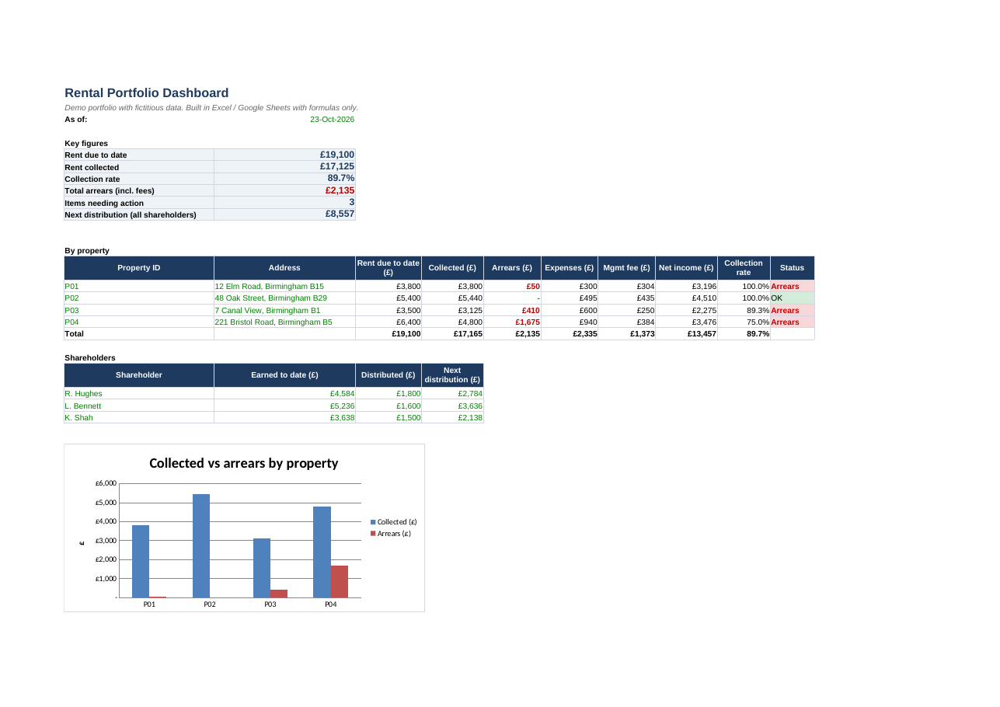
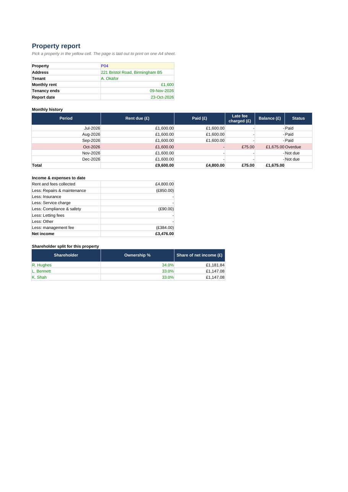
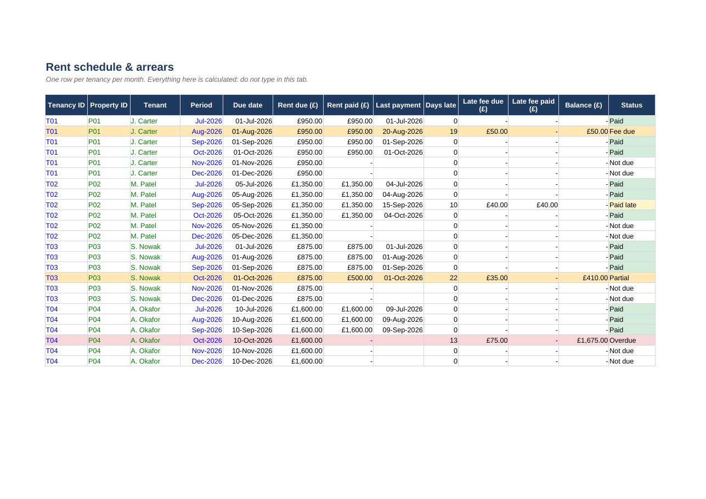

# Rental Portfolio Tracker (Excel / Google Sheets)

A rental management workbook driven by a single payments ledger. Type a payment and everything else updates: arrears, late fees, each shareholder's return and a one-page report per property.

> Demo data only. Every name, address and amount is fictitious.

## What it does
- **Payments ledger:** date, tenancy, rent period, amount, method and late fee. Partial payments are flagged automatically.
- **Rent schedule:** one line per tenancy per month, with days late, the late fee applied after the grace period, the balance and a colour-coded status (Paid / Paid late / Partial / Fee due / Overdue).
- **Dashboard:** rent due, rent collected, collection rate, total arrears, items needing action and the next shareholder distribution.
- **Shareholder returns:** each shareholder owns a different % of each property, so returns follow each property's net income (rent collected minus expenses minus management fee), less distributions already paid.
- **Property report:** pick a property from a drop-down and print it on one A4 page.
- **Handover guide:** written so any team member can maintain the workbook.
- **Optional alerts:** a Google Apps Script e-mails the list of overdue items every morning ([apps-script/rental_tracker_alerts.gs](apps-script/rental_tracker_alerts.gs)).

| Property report | Rent schedule |
|---|---|
|  |  |

## How to try it
1. Download `Rental_Tracker_Demo.xlsx`. It opens in Excel or, after uploading to Google Drive, in Google Sheets.
2. Add a payment row in **Payments** and watch the **Dashboard** update.
3. Optional: in Google Sheets, open Extensions > Apps Script, paste the `.gs` file, set your e-mail and run `installDailyTrigger()`.

## Built with
Plain spreadsheet formulas (SUMIFS, INDEX/MATCH, MAXIFS), data validation and conditional formatting, with no macros. The Google Sheets version can generate the schedule automatically with ARRAYFORMULA/QUERY.

## Author
Rodrigo Matoso: real estate appraiser and broker (Brazil), building data tools for property businesses.
Available for custom versions on Freelancer.com, Upwork and Workana.

## License
MIT
